  

  
  
  

<h1 align="center">Hello Friends </h1>

  

  Hi! My name is <b>Chamudini Dilhara</b>. I'm a Software Engineer currently studying at <b>NIBM University, Sri Lanka</b> 🎓

  
  
  

<h2 align="center">Skills </h2>

<h2 align="center">Connect with me </h2>

<h2 align="center" id="github-contribution-streak">Github Contribution Streak & Contribution Graph 📈</h2>

    

    <picture align="center">
      <source media="(prefers-color-scheme: dark)" srcset="https://raw.githubusercontent.com/Niefee/niefee/master/assets/github-contribution-grid-snake.svg">
      <source media="(prefers-color-scheme: light)" srcset="https://raw.githubusercontent.com/Niefee/niefee/master/assets/github-contribution-grid-snake.svg">
      
    </picture>

  

